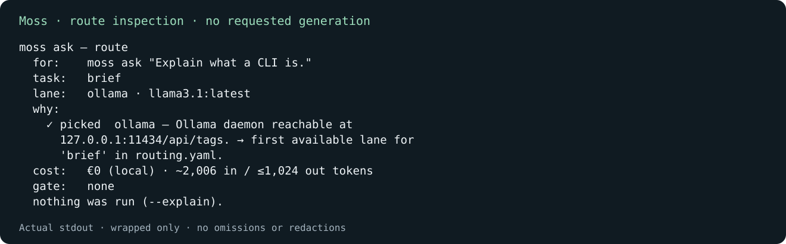

# Moss

**Local-first AI orchestration with explicit routing, cost controls and human approval.**

**Experimental; not release-ready.**

Moss is an experimental CLI for explicit provider routing, usage/cost visibility, bounded context and human-reviewed changes. Its task-based session workflows select from configured local and hosted lanes; some standalone commands still use an older router (see [routing limits](LIMITATIONS.md#models-and-routing)).

The aim is not to build an autonomous agent. Moss uses fixed workflows: it makes the routing decision visible, prepares bounded context, and requires a person to approve changes before they are applied.

Maintained by [Karl Doyle](https://github.com/KarlDoyle). Source: [github.com/KarlDoyle/moss-public](https://github.com/KarlDoyle/moss-public).

## What it does

- **Routes by task.** Selects a provider lane based on the kind of work and the configured routing policy.
- **Keeps local work local.** Uses Ollama for tasks configured to run on a local model.
- **Supports hosted models when needed.** Can use Claude through the Claude Code CLI or the Anthropic API.
- **Makes cost visible.** Shows route rationale and usage estimates. The task-policy router checks a configurable daily Anthropic API budget (default €2; API lane disabled by default); this does not cover every API path.
- **Keeps the human in control.** Offers route inspection and requires approval before `/edit` applies changes. Local Aider application is a second generation and may differ from its dry run.
- **Constrains execution.** Centralised checks restrict supported paths, subprocesses and direct HTTP destinations; they are application controls, not an independently audited sandbox.

## Provider model

| Lane | Provider | Typical use | Cost model |
|---|---|---|---|
| `ollama` | Local Ollama model | Tasks configured for local execution | No per-call provider charge |
| `claude-code` | Claude via `claude -p` | Hosted reasoning and editing when the CLI is available | Cost depends on the account and plan used by the CLI |
| `anthropic-api` | Anthropic API | Metered hosted calls | Estimated EUR; cap only on task-policy routes |

The default session and external-workspace skills use `config/routing.yaml`: route/brief/embed/vision are configured local, while reason/edit prefer Claude Code, then the enabled Anthropic API lane, then local Ollama. These are routing categories, not evidence that every modality is exposed in the session. Unavailable lanes are skipped; a generation failure on these routes is reported, without a second dispatch. Local-first does **not** mean every request is local.

Standalone `ask` uses an older provider-order router with retryable-error fallback and can reach hosted lanes unless pinned. It does not enforce the task-policy API enable switch or spend cap. Use an explicit local provider and model for a local-only `ask`. Provider accounts, supported models and behaviour differ; this is not a universal provider abstraction.

## Human approval and safety

Moss uses fixed workflows rather than open-ended model autonomy:

- **Route inspection:** `--explain` skips the requested generation, but availability probes can contact providers. Global `--explain ask` previews the task policy; `ask --explain` previews the older router. They are not interchangeable.
- **Approval:** Claude-lane `/edit` checks planned paths and `git apply --check`, shows a diff, then asks `go? [y/N]` before applying it. Local Aider runs dry first and asks before a second generation; inspect the final `git diff`. Neither flow commits.
- **Stage-only:** recognised irreversible/external-facing gates suppress application, not provider dispatch. Gate detection depends on an optional external workspace hook; it is not a universal intent classifier.
- **Context and execution:** explicit file checks and a bounded chat transcript reduce exposure. Subprocess allowlists do not contain every action of an allowed child; Claude Code and Aider do their own networking. Optional workspace integrations and telemetry can access paths outside this checkout.
- **Credentials and logs:** the API key comes from `ANTHROPIC_API_KEY` or macOS Keychain. Usage logs contain metadata, not prompt/response bodies; reports and terminal output can contain source material. Review these before sharing.

The daily cap applies to Anthropic Messages API requests selected through the task-policy router: default chat, its hosted edit planning/diff calls, and external-workspace skill runs. Before selection it compares today's local ledger estimate plus an estimated input/output allowance with the cap. It is not a provider billing limit: older `ask`/legacy chat routes, Claude Code calls/probes, other applications, concurrent requests and missing ledger entries are outside that accounting. EUR uses list prices and a dated exchange rate, not actual provider charges. See [limitations](LIMITATIONS.md).

## How it fits together

Moss brings provider selection, context handling and application-level safety checks into a terminal workflow. Local model execution is handled through Ollama; hosted calls use the configured Claude lane. For local editing, Aider can produce the change; on a Claude lane, Moss receives a proposed unified diff. In either case, the change is reviewed before application.

The workflow is deliberately fixed and inspectable. Model output is treated as a proposal to evaluate, not as an authoritative record or permission to take the next action.

## Quick start

Moss currently runs from a source checkout; it is not distributed as a prebuilt global package. Requires Node.js 24 or later and pnpm 10 or later. Ollama and the configured local model are needed for local execution.

```bash
git clone https://github.com/KarlDoyle/moss-public.git
cd moss-public
pnpm install --frozen-lockfile
pnpm exec tsx ./src/cli.ts --help
pnpm exec tsx ./src/cli.ts --version
# Inspect only: no requested generation; local daemon/model must be available.
TAISCE_ROOT=/tmp/moss-public-no-workspace MOSS_NO_OLLAMA_LIFECYCLE=1 \
  pnpm exec tsx ./src/cli.ts --explain ask "Explain what a CLI is."
```

Use the pinned pnpm version in `package.json`. The examples use a POSIX shell; macOS-specific lifecycle, Keychain and operator integrations are optional, not portable setup steps. Install/start Ollama and pull the configured model before local generation; Moss never pulls models automatically. See [First run](docs/FIRST_RUN.md) for a provider-pinned request and the distinction between inspection and dispatch.



Route inspection captured from this checkout on 2 November 2026 using the command above. The external workspace was disabled with an absent temporary path; the local daemon was already running. Output is wrapped for display; no omissions or redactions. This is not model-quality, security or cost-savings evidence; €0 means no per-call provider charge.

## Core commands

| Command | Purpose |
|---|---|
| `moss` | Open the interactive session |
| `moss --explain <command>` | Inspect task-policy routing; probes may contact providers |
| `moss status` | Inspect provider availability, fallback state and recent usage |
| `moss cost` | Review usage and spend by provider |
| `moss bench` | Measure local model throughput and cold-load time |
| `moss check` | Specialist machine/workspace diagnostics; may query registries |
| `moss run <skill>` | Built-in local diff review, or an external workspace skill |
| `moss help --all` | Show the full command reference |

## CLI command reference

The current CLI registers these commands:

`chat` · `run` · `ask` · `status` · `local` · `credits` · `api` · `sub` · `check` · `cost` · `bench` · `doctor` · `off` · `models` · `auth` · `skills` · `plan` · `litellm` · `tools` · `inventory` · `context` · `convert` · `remember` · `recall` · `compact` · `forget`

Start with chat, pinned `ask`, route inspection and built-in diff reviews. `run` also discovers skills in a separately configured Taisce workspace; those skills are not bundled here. `local`/`off`, `check` and the tier helpers are specialist operator integrations. Models/auth, plans, LiteLLM/MCP tools, documents and memory commands are parked outside default help; retained registration does not make them the supported portfolio workflow. Run `moss help --all` for the full surface.

## Scope and status

**Status: Experimental; not release-ready.**

Moss is an **experimental local AI orchestration project**. Its current focus is provider routing, cost and usage visibility, controlled context, and explicit execution boundaries.

It is not presented as a general-purpose autonomous agent or a finished enterprise platform. Some earlier document, memory and optional integration capabilities remain in the repository but are outside the current development focus.

## Testing

Run the existing gates from the checkout (no model generation required):

```bash
pnpm typecheck   # tsc --noEmit
pnpm lint        # biome check .
pnpm test        # vitest run --coverage (pnpm coverage is an alias)
pnpm build       # placeholder: prints a message only
```

Coverage thresholds are 79% statements, 69% branches, 76% functions and 80% lines. The **build script produces no compiled/distributable artefact**. Installation's `prepare` script attempts to enable `.githooks/pre-push`, which runs typecheck and coverage tests, including documentation-surface checks. Local hooks are bypassable and do not run lint. GitHub [CI](.github/workflows/ci.yml) separately installs with the frozen lockfile, runs typecheck, lint, coverage tests and CLI smoke checks; it does not run build. Consult [Actions](https://github.com/KarlDoyle/moss-public/actions) for the relevant commit's result; local success is not a CI result.

## Further reading

- [First run](docs/FIRST_RUN.md) — setup and first-use steps.
- [Operator guide](docs/OPERATOR_GUIDE.md) — everyday commands and workflows.
- [Limitations](LIMITATIONS.md) and [Future](FUTURE.md) — known limitations and planned work.

## Engineering decisions

- **Explicit task-based routing:** a YAML policy chooses lane/model for session workflows, rather than asking a model to choose. Trade-off: predictable selection needs maintained configuration, and the older standalone router still differs.
- **Fixed workflows with human approval:** diffs are proposals and application is a separate step. Trade-off: manual review takes time, and local Aider application is another generation.
- **Bounded context and explicit hosted lanes:** selected files and capped session history limit prompt growth; hosted providers are named lanes. Trade-off: omitted context can reduce usefulness, and choosing a hosted route sends supplied context off-machine. This is not retrieval or comprehensive workspace understanding.

## Engineering approach

AI assistants helped with implementation and test development. I chose the architecture, reviewed behaviour and decide which changes to keep.

## Licence

Moss is licensed under the MIT License. See [LICENSE](LICENSE).
